# Awesome Generative 3D CAD & Parametric Modeling 📐✨

<p align="center">
  
</p>

<p align="center">
  <a href="https://github.com/ishandutta2007/Awesome-Awesome-Awesome"></a>
  <a href="https://discord.gg/jc4xtF58Ve"></a>
  <a href="https://github.com/ishandutta2007/Awesome-Generative-3D-CAD-Parametric-Modeling"></a>
  <a href="https://github.com/ishandutta2007/Awesome-Generative-3D-CAD-Parametric-Modeling/fork"></a>
  <a href="https://github.com/ishandutta2007"></a>
</p>

---

## 📖 Introduction & SEO Overview 🚀

A comprehensive, curated collection of cutting-edge **Generative 3D CAD**, **AI Text-to-CAD generators**, **Code-First Parametric Modeling frameworks (Python / Rust / JavaScript)**, **OpenCASCADE boundary representation (B-Rep) geometry kernels**, and **Implicit Lattice / Topology Optimization platforms**.

Whether you are developing automated AI CAD pipelines, mechanical hardware systems, 3D printing workflows, or algorithmic engineering tools, this directory tracks industry-leading **commercial SaaS platforms** and high-velocity **open-source repositories**.

### 🌟 Key Highlights & Domains
- 🤖 **AI Generative & Text-to-CAD**: Natural language prompt-to-STEP/B-Rep synthesis and parametric feature tree reconstruction.
- 🐍 **Code-First Programmatic CAD**: Git-trackable, script-driven solid modeling via Python (`CadQuery`, `build123d`), Rust (`Truck`, `KCL`), and JavaScript (`JSCAD`).
- 🧊 **Boundary Representation (B-Rep) & Kernels**: Industrial NURBS geometry engines and constructive solid geometry (CSG) systems.
- 🔬 **Implicit Modeling & Topology Optimization**: Gyroid infills, signed distance fields (SDFs), and conformal lattice structures for aerospace and additive manufacturing.
- ☁️ **Cloud Collaborative CAD & PLM**: Multi-tenant browser-native mechanical modeling and real-time multiplayer CAD.

---

## 📑 Table of Contents 🧭

- [📊 Sector Overview & Market Dynamics](#-sector-overview--market-dynamics)
- [☁️ SaaS & Commercial CAD Platforms](#️-saas--commercial-cad-platforms)
- [💻 Open-Source GitHub Projects](#-open-source-github-projects)
- [📈 Star History](#-star-history)
- [🛠️ How to Contribute](#️-how-to-contribute)
- [💖 Support & Sponsorship](#-support--sponsorship)
- [⚠️ Disclaimer](#️-disclaimer)

---

## 📊 Sector Overview & Market Dynamics 📈

The global Mechanical CAD (MCAD), Generative Design & Parametric Modeling Software market is valued at approximately **$14.2B–$17.5B+ in 2026**, expanding at a ~10%–14% CAGR driven by cloud-native collaborative CAD, AI Text-to-CAD B-Rep generation, and additive-manufacturing lattice optimization. The enterprise PLM/MCAD layer exhibits **strong winner-take-most consolidation** around Dassault Systèmes, Siemens Digital Industries, Autodesk, and PTC, while the **code-first parametric CAD, browser WebAssembly B-Rep, and generative AI CAD ecosystems are rapidly growing around open-source tools** (`FreeCAD`, `build123d`, `CadQuery`, `OpenSCAD`, `OpenCASCADE`, `libfive`).

---

## ☁️ SaaS & Commercial CAD Platforms 💼

*Sorted descending by company valuation / annual revenue scale.*

| Platform | Description | Company Scale (Valuation / Revenue) | Starting Paid Tier | Free Tier / Trial Limit |
| :--- | :--- | :--- | :--- | :--- |
| **[Siemens NX Cloud (Siemens Xcelerator)](https://siemens.com)** 🏢 | Enterprise cloud-streamed and browser-accessible CAD/CAM/CAE suite featuring convergent modeling, generative engineering, and digital twins. | **Part of Siemens AG** (~$82B+ Siemens group revenue; ~$150B+ market cap) | **~$250 – $450+ / month** billed annually (NX X Cloud SaaS subscription tiers) | **30-Day Full-Access Free Trial** (Browser-streamed Siemens NX X trial workspace with zero local installation; free Student Edition) |
| **[Autodesk Fusion 360](https://autodesk.com)** 🎨 | Cloud-connected 3D parametric CAD, CAM, CAE, PCB, and AI generative design platform widely used across product design and CNC manufacturing. | **Part of Autodesk Inc.** (~$6.1B+ annual revenue; ~$60B+ market cap) | **$85 / month** ($680 / year billed annually for commercial Fusion subscription) | **Forever Free Personal Use License** (100% free non-commercial hobbyist license limited to **10 active editable documents** + 30-day commercial trial) |
| **[Tinkercad (Autodesk)](https://tinkercad.com)** 🧩 | Browser-based constructive solid geometry (CSG) 3D CAD, Codeblocks parametric visual scripting, and electronics circuit simulator. | **Part of Autodesk Inc.** (~$6.1B+ annual revenue; ~$60B+ market cap) | **$0 / Free Web Platform** (100% free browser-hosted SaaS for educators, students, and makers) | **100% Free Forever** (Unlimited browser 3D designs, Codeblocks parametric scripts, and STL/OBJ/SVG exports at zero cost) |
| **[Dassault Systèmes 3DEXPERIENCE (SOLIDWORKS / CATIA)](https://3ds.com)** 🏛️ | Cloud-connected enterprise parametric CAD, generative design, and PLM platform uniting SOLIDWORKS, CATIA, and SIMULIA in the browser. | **~$6.5B+ Annual Revenue** (~$50B+ public market cap on Euronext Paris) | **~$15 / month** ($48/yr 3DEXPERIENCE SOLIDWORKS for Makers; commercial seats ~$2,800+/yr) | **Guided Enterprise Trial** (No perpetual free commercial tier; low-cost $48/yr Maker tier and student academic programs available) |
| **[Onshape (PTC)](https://onshape.com)** 🌐 | Cloud-native, browser-first parametric CAD and PDM platform with real-time Google-Docs-style multiplayer collaboration and FeatureScript. | **Part of PTC Inc.** (Acquired for $470M; ~$2.3B+ PTC annual revenue) | **$1,500 / user / year** for Onshape Standard (or $2,500/yr Professional with release management) | **Forever Free Hobbyist Plan** (Unlimited cloud parametric CAD and FeatureScript access with **all documents publicly viewable**; 6-month Startup trial) |
| **[PTC Creo Cloud (Creo+)](https://ptc.com)** ⚙️ | SaaS-delivered enterprise parametric 3D CAD suite featuring generative topology optimization, real-time simulation, and cloud collaboration. | **Part of PTC Inc.** (~$2.3B+ annual revenue; ~$22B+ public market cap on NASDAQ) | **~$2,700+ / user / year** indicative starting Creo+ SaaS subscription | **30-Day Full-Access Free Trial** (Cloud-streamed Creo trial environment with generative design modules; free Creo Student Edition) |
| **[nTop (formerly nTopology)](https://ntop.com)** 🔬 | Implicit-modeling and computational engineering software automating complex gyroid lattices, heat exchangers, and generative topology optimization. | **~$200M–$350M Est. Valuation** ($135M+ VC funding led by Tiger Global/Insight) | **~$15,000 – $25,000+ / year** indicative enterprise engineering seat subscription | **Guided Enterprise Demo / Academic Grant** (No public self-serve free tier; free academic licenses for verified university researchers) |
| **[Shapr3D](https://shapr3d.com)** ✏️ | Parasolid-powered cross-platform 3D CAD app with history-based parametric modeling and AI-assisted visualization on iPad, macOS, and Windows. | **~$100M–$150M Est. Valuation** (~$20M+ est. ARR; $40M+ VC funding) | **$25 / month** billed annually ($38/mo monthly for Pro tier with STEP/IGES export) | **Forever Free Basic Plan** (Up to **2 active designs**, full parametric/direct modeling tools, and low-res STL/3MF export; free EDU Pro) |
| **[Rhino.Compute (Robert McNeel & Associates)](https://rhino3d.com)** 🦏 | Headless cloud REST API and geometry server running Rhino 3D and Grasshopper visual parametric algorithms at scale in web apps and pipelines. | **~$50M–$100M Est. Scale** (Profitable, employee-owned NURBS CAD pioneer) | **$0.10 / core-hour** pay-as-you-go compute billing (plus **$995 one-time** Rhino 8 perpetual license) | **90-Day Full-Access Free Trial** (Full Rhino 8 + Grasshopper + Rhino.Compute evaluation for 90 days; $195 one-time student license) |
| **[Shapeways / Thangs Cloud CAD Ecosystem](https://shapeways.com)** 🖨️ | Cloud 3D printing, automated manufacturability (DFM) analysis, and parametric print-on-demand marketplace for custom 3D CAD models. | **Relaunched / Mid-Market Manufacturing Scale** (~$20M–$35M+ group scale) | **Pay-per-print / API manufacturing quotes** (Starting ~$5–$15 per custom 3D-printed part) | **Forever Free Model Upload & DFM Checks** (Free cloud mesh repair, wall-thickness manufacturability checks, and storefront hosting) |

---

## 💻 Open-Source GitHub Projects 🛠️

*Sorted descending by repository GitHub Stars_Count.*

| Project | Stars_Badge | Language / Focus | Description |
| :--- | :---: | :--- | :--- |
| **[FreeCAD](https://github.com/FreeCAD/FreeCAD)** 📐 | [](https://github.com/FreeCAD/FreeCAD/stargazers) | C++ / Python (GUI & Kernel) | Official source code of FreeCAD, a free and open-source multiplatform 3D parametric modeler supporting modular workbenches and OpenCASCADE geometry. |
| **[earthtojake/text-to-cad](https://github.com/earthtojake/text-to-cad)** 🤖 | [](https://github.com/earthtojake/text-to-cad/stargazers) | TypeScript / Python (AI CAD) | Open-source prompt-driven AI tool to design physical products directly from natural language prompts, producing parametric 3D CAD models. |
| **[OpenSCAD](https://github.com/openscad/openscad)** 💻 | [](https://github.com/openscad/openscad/stargazers) | C++ (Parametric CSG) | The Programmers' Solid 3D CAD Modeler. Compiles procedural script files into 3D constructive solid geometry models without interactive GUI drawing. |
| **[CadQuery](https://github.com/CadQuery/cadquery)** 🐍 | [](https://github.com/CadQuery/cadquery/stargazers) | Python (B-Rep Framework) | Python parametric CAD scripting framework based on OpenCASCADE (OCCT), allowing programmatic creation of production-grade STEP models. |
| **[Amagine3D](https://github.com/amagine-ai/Amagine3D)** 🧠 | [](https://github.com/amagine-ai/Amagine3D/stargazers) | Python / AI | Next-generation generative CAD agent turning hardware engineering specifications and natural language requirements into editable 3D designs. |
| **[CADAM](https://github.com/Adam-CAD/CADAM)** ⚡ | [](https://github.com/Adam-CAD/CADAM/stargazers) | Python / Web (Text-to-CAD) | Open-source web application for text-to-CAD generation, enabling prompt-driven geometric synthesis and interactive 3D inspection. |
| **[SolveSpace](https://github.com/solvespace/solvespace)** 📏 | [](https://github.com/solvespace/solvespace/stargazers) | C++ (Parametric 2D/3D) | Lightweight parametric 2D/3D CAD software with geometric constraint solving, kinematic mechanism simulation, and CAM toolpath export. |
| **[build123d](https://github.com/gumyr/build123d)** 🏗️ | [](https://github.com/gumyr/build123d/stargazers) | Python (Modern CAD) | Modern, intuitive Python 3D CAD programming library based on OCCT with dedicated 1D/2D/3D builder paradigms and algebraic operations. |
| **[JSCAD (OpenJSCAD)](https://github.com/jscad/OpenJSCAD.org)** 🟨 | [](https://github.com/jscad/OpenJSCAD.org/stargazers) | JavaScript (Browser CAD) | Modular browser and CLI toolkit for generating programmatic 2D/3D parametric CAD designs using modern JavaScript code and CSG operations. |
| **[Antimony](https://github.com/mkeeter/antimony)** 🔮 | [](https://github.com/mkeeter/antimony/stargazers) | C++ / Python (Graph CAD) | Node-based parametric CAD system built around functional representations (implicit surfaces) and graphical dataflow graphs. |
| **[fogleman/sdf](https://github.com/fogleman/sdf)** 🧊 | [](https://github.com/fogleman/sdf/stargazers) | Python (SDF Modeling) | Fast, simple Signed Distance Field (SDF) mesh generation library in Python supporting procedural volumetric modeling and marching cubes. |
| **[pythonocc-core](https://github.com/tpaviot/pythonocc-core)** 🐍 | [](https://github.com/tpaviot/pythonocc-core/stargazers) | Python / C++ (OCCT Wrapper) | Comprehensive Python wrapper for OpenCASCADE Community Edition (OCE/OCCT), enabling low-level B-Rep CAD, BIM, and CAM algorithms. |
| **[libfive](https://github.com/libfive/libfive)** 🧬 | [](https://github.com/libfive/libfive/stargazers) | C++ / Guile / Python | High-performance infrastructure and kernel for volumetric solid modeling via implicit surfaces and tree-based functional representations. |
| **[Zoo Design Studio (KittyCAD)](https://github.com/KittyCAD/modeling-app)** 🐱 | [](https://github.com/KittyCAD/modeling-app/stargazers) | Rust / TypeScript / WebAssembly | The official Zoo (KittyCAD) Design Studio app, offering browser-based hardware design powered by KCL (KittyCAD Language) and cloud GPU rendering. |
| **[CQ-Editor](https://github.com/CadQuery/CQ-editor)** 🖥️ | [](https://github.com/CadQuery/CQ-editor/stargazers) | Python / Qt (IDE) | Official GUI and IDE for CadQuery based on PySide/PyQt with live code reload, STEP export, and interactive 3D inspection. |
| **[Curv](https://github.com/curv3d/curv)** 🌈 | [](https://github.com/curv3d/curv/stargazers) | C++ (Mathematical CAD) | Functional programming language for making art and mechanical parts using mathematics, transforming implicit signed distance fields into meshes. |
| **[Multi-Agent CAD](https://github.com/Pan-Chera/Multi-Agent-CAD)** 🤝 | [](https://github.com/Pan-Chera/Multi-Agent-CAD/stargazers) | Python / LLM Agents | Decoupled multi-agent framework generating complex CAD geometry from natural language prompts using constrained test-time compute. |
| **[fstl](https://github.com/fstl-app/fstl)** ⚡ | [](https://github.com/fstl-app/fstl/stargazers) | C++ / OpenGL (Viewer) | Ultra-fast, lightweight 3D viewer designed for rendering massive multi-million polygon STL files without lag. |

---

## 📈 Star History 📊

[](https://www.star-history.com/#ishandutta2007/Awesome-Generative-3D-CAD-Parametric-Modeling&type=date&legend=top-left)

---

## 🛠️ How to Contribute 🤝

Contributions are welcome and appreciated! To maintain the highest curation quality:

1. **Fork the repository** 🍴 and create your feature branch:
   ```bash
   git checkout -b feature/new-cad-tool
   ```
2. **Add the tool** into the appropriate table adhering to the established format:
   - For SaaS tools: ensure pricing and free-tier limits are accurately detailed.
   - For open-source tools: include the GitHub Stars_Badge linking to its `/stargazers` page.
3. **Commit your changes** with descriptive commit messages:
   ```bash
   git commit -m "feat: add NewCADTool to open-source parametric category"
   ```
4. **Push to your branch** and submit a **Pull Request** 🚀.

---

## 💖 Support & Sponsorship ☕

If this curated repository saved you hours of research or assisted your 3D CAD and AI generative workflow, please consider showing your support:

- ⭐ **Star this repository** to help others discover it across GitHub.
- 🍴 **Fork and share** it with fellow mechanical engineers, researchers, and makers.
- ☕ **Sponsor or buy a coffee** via the [GitHub Sponsors Dashboard](https://github.com/sponsors/ishandutta2007).

Your sponsorship directly funds the continuous tracking, updating, and benchmarking of open-source generative engineering software!

---

## ⚠️ Disclaimer 📋

*All product names, logos, trademarks, and registered trademarks belong to their respective owners. Company valuations, market capitalization numbers, and pricing tiers represent public estimates and publicly published figures as of November 2026. Verify current enterprise pricing directly with vendor licensing representatives before making procurement decisions.*
